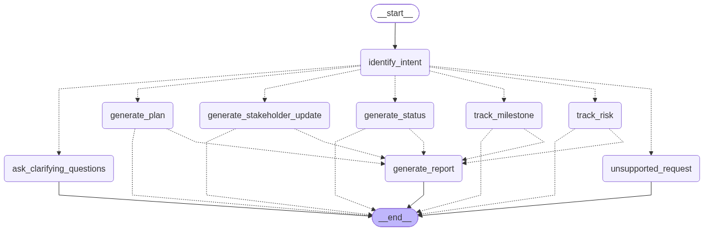
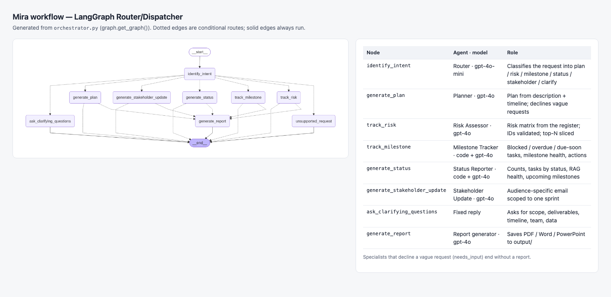
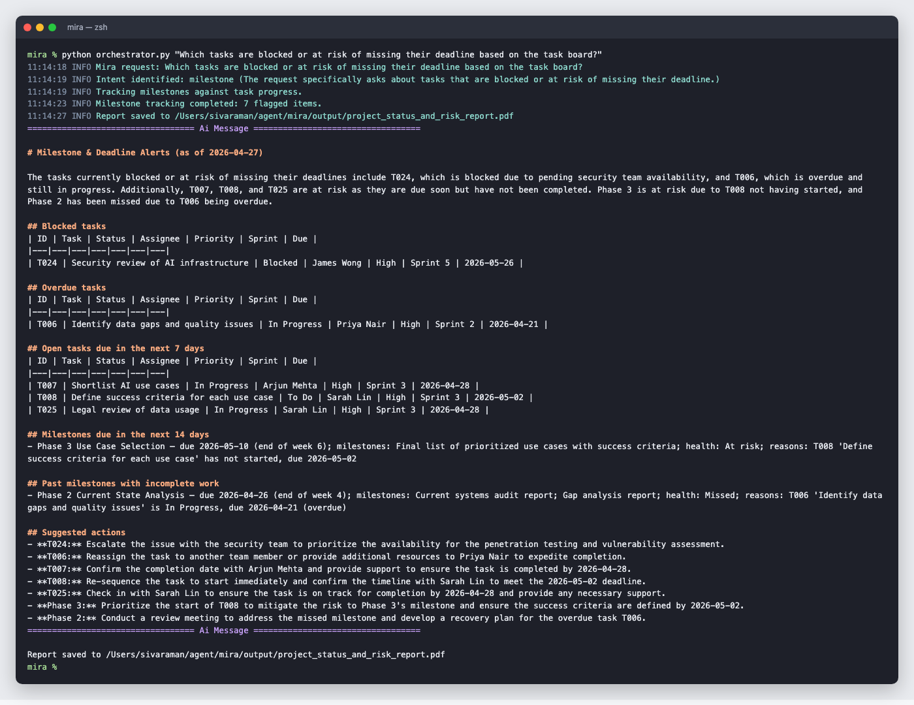
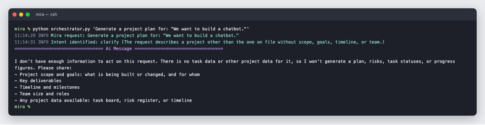
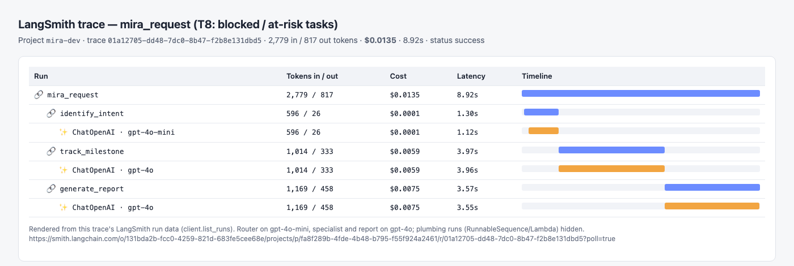
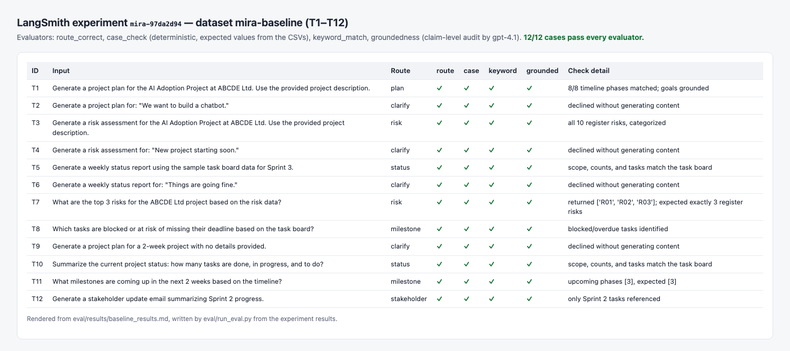

# Mira — AI-Powered Project Intelligence Assistant

Mira turns raw project data (description, timeline, risk register, task board) into structured,
grounded outputs for PMs/TPMs at Nexora: project plans, risk assessments, weekly status reports,
milestone and deadline alerts, and audience-specific stakeholder updates. It is built for the
ABCDE Ltd. AI Adoption Project capstone.

**Baseline result: 12/12 test cases pass every evaluator** — see
[eval/results/baseline_results.md](eval/results/baseline_results.md).

## Quick start

```bash
pip install -r requirements.txt
cp .env.example .env            # add your OpenAI and LangSmith keys
python orchestrator.py "What are the top 3 risks for the ABCDE Ltd project?"
```

Answers print in the terminal; content-producing requests also save a formatted report
(PDF, Word, or PowerPoint, chosen by Mira) to `output/`.

Run the baseline evaluation:

```bash
python -m eval.upload_dataset   # push eval/datasets/mira_baseline.py to LangSmith
python -m eval.run_eval         # run T1-T12, score, and write eval/results/baseline_results.md
```

## Architecture



Mira is a [LangGraph](https://langchain-ai.github.io/langgraph/) state machine
(source: [orchestrator.py](orchestrator.py); exported as [workflow.json](workflow.json) and
[graph.mmd](graph.mmd)).

1. **`identify_intent`** (router) classifies the request into one of six intents with a small,
   cheap model and a fixed label set, logging a one-sentence reason to the trace.
2. A **conditional edge** dispatches to exactly one specialist agent.
3. Each specialist either produces content or **declines** a request that lacks the detail to act
   on (`needs_input`). Declines go straight back to the user; content goes to
   **`generate_report`**, which formats it as a document.

### Orchestration pattern: Router / Dispatcher

| Pattern considered | Verdict |
|---|---|
| Sequential pipeline (plan → risks → status for every input) | Rejected. Requests are single-purpose ("top 3 risks", "Sprint 3 status"); running every agent wastes cost and latency, and blends unrelated outputs. |
| **Router / Dispatcher** | **Chosen.** Request types map cleanly to specialists, routing is a cheap classification, and the route is an evaluable output (`route_correct`). A `clarify` route stops vague requests before any content is generated. |
| Hierarchical (orchestrator decomposes into subtasks) | Deferred. Useful for compound requests ("plan and risks for leadership"), but none of the baseline cases need it; it adds planning cost and failure modes. Listed as future work. |

### Agents

| Node | Agent | Inputs (only these files) | Deterministic in code | LLM writes |
|---|---|---|---|---|
| `identify_intent` | Intent identifier (router) | User request | Empty-request handling | Intent label + reason (`gpt-4o-mini`) |
| `generate_plan` | Planner | Description, timeline, company intro | — | Structured plan; must decline vague requests |
| `track_risk` | Risk Assessor | Description, intro, risk register, timeline, task board | Risk IDs validated against the register; derived risks need evidence; top-N sliced from the full ranking | Structured risk matrix with priorities and rationale |
| `generate_status` | Status Reporter | Task board, timeline | Sprint filter, counts, task lists, RAG health, upcoming milestones | Headline, highlights, concerns, next steps |
| `track_milestone` | Milestone Tracker (extended) | Task board, timeline | Blocked/overdue/due-soon tasks, milestone windows and health | Summary and one action per flagged item |
| `generate_stakeholder_update` | Stakeholder Update Generator (extended) | Task board, timeline | Audience and sprint scope; regenerates if out-of-scope tasks appear | Audience-specific email |
| `ask_clarifying_questions` | — | — | Fixed reply asking for scope, deliverables, timeline, team, data | — |
| `generate_report` | Report generator | Specialist output | File rendering | Format choice and sectioning |

Agent code lives in [agent/planner/](agent/planner/); shared data access in
[utils/project_data.py](utils/project_data.py).

### Grounding strategy

- **Exact facts come from code, not the model.** Counts, task IDs, due-date checks, milestone
  windows, and health ratings are computed from the CSVs; the LLM only writes prose around them.
- **Per-agent context.** Each agent loads only the files it needs. The eval inputs file and the
  duplicate PDF/DOCX copies are never loaded.
- **Structured output.** Every specialist returns a Pydantic model, so results are validated and
  checkable (`result` in graph state).
- **Decline instead of invent.** The router and each specialist refuse vague requests and ask for
  scope, goals, deliverables, timeline, team, and data.
- **Prompt-injection hygiene.** All project data and user text is wrapped in tags and treated as data.

### Tools and technology

| Need | Choice | Why |
|---|---|---|
| Agent platform | LangGraph (Python) | Code-first graph with typed state and conditional routing; version-controlled and testable. The brief allows any platform; the graph is exported as [workflow.json](workflow.json). |
| LLMs | `gpt-4o` (agents), `gpt-4o-mini` (router), `gpt-4.1` (eval judge) | Quality where it matters, a cheap model for classification, and a *different* judge model so the evaluator doesn't grade its own model family's output. |
| Data ingestion | CSV/TXT/PDF/DOCX loaders ([utils/resource_loader.py](utils/resource_loader.py)) | Read the provided files directly. |
| Observability | LangSmith | Traces every node and LLM call with token usage and cost; hosts the dataset and experiments. |
| Output | Markdown in chat; PDF/DOCX/PPTX files | Immediately usable by PMs and shareable with stakeholders. |

## Assumptions

The timeline is in project weeks and the brief gives no "today" date, so status and milestone
checks use two configurable dates ([utils/project_data.py](utils/project_data.py)):

- **Project week 1 starts 2026-03-30** (`MIRA_PROJECT_START`), chosen so every task's due date falls
  inside its timeline phase.
- **As-of date 2026-04-27** (`MIRA_AS_OF_DATE`), the task board snapshot at the start of Sprint 3.

The problem statement says the board has "3 Done"; the actual CSV has **5 Done, 3 In Progress,
1 Blocked, 16 To Do**. Mira and the eval use the CSV.

## Evaluation

- **Dataset:** T1-T12 verbatim from `resources/eval_mira_inputs.txt`
  ([eval/datasets/mira_baseline.py](eval/datasets/mira_baseline.py)). Expected values are
  hand-copied from the CSVs, so checks don't reuse Mira's own logic.
- **Evaluators** ([eval/evaluators/](eval/evaluators/)):
  - `route_correct`: the router chose an acceptable agent.
  - `case_check`: per-case deterministic check (8/8 phases, all 10 register risks, exact counts,
    T024 identified, Phase 3 upcoming, Sprint-2-only email, declines produce nothing).
  - `keyword_match`: cheap tripwire.
  - `groundedness`: claim-by-claim LLM audit (`gpt-4.1`) against the project files and the
    documented computation rules.
- **Result:** 12/12 pass on every evaluator (experiment `mira-97da2d94`).

### Cost and latency (measured in LangSmith, experiment `mira-97da2d94`)

| Request type | Example | Tokens in / out | Cost | Latency |
|---|---|---|---|---|
| Project plan | T1 | 3,879 / 1,389 | $0.0196 | 10.0 s |
| Full risk assessment | T3 | 5,311 / 1,418 | $0.0217 | 9.7 s |
| Top-3 risks | T7 | 4,877 / 1,400 | $0.0204 | 9.3 s |
| Status report | T5 / T10 | 2,442-3,818 / 708-911 | $0.0116-0.0153 | 6-7 s |
| Milestone alerts | T8 / T11 | 2,729-2,776 / 712-802 | $0.0123-0.0133 | 6 s |
| Stakeholder email | T12 | 1,852 / 527 | $0.0083 | 4.8 s |
| Declined (vague) | T2, T4, T6, T9 | ~590 / ~30 | $0.0001 | 0.8 s |
| **All 12 cases** | | 30,054 / 7,978 | **$0.123** | |

**Cost per plan: about $0.02.** The eval judge (`gpt-4.1`) is extra and not included. For 10
PMs making about 10 requests each per week, generation costs about $1.50/week. The report
generator is roughly a third of each request's cost; rendering reports straight from the
structured result would remove that call.

## Repository layout

```
mira/
├── orchestrator.py          # graph definition and CLI
├── agent/planner/           # router and specialist agents, report generator
├── utils/                   # data access, model setup, loaders, logging
├── observability/           # LangSmith client and run config
├── eval/                    # dataset, evaluators, runner, results
├── resources/               # provided project files
├── docs/                    # Q1-Q4 written deliverables
├── graph.png / graph.mmd / workflow.json
└── requirements.txt / .env.example
```

## Screenshots

| | |
|---|---|
| **Workflow canvas** — LangGraph graph with each node's agent and model |  |
| **Mira in action** — T8: blocked and at-risk tasks, with suggested actions |  |
| **Mira in action** — T2: a vague request is declined with clarifying questions |  |
| **Observability** — LangSmith trace of the T8 run: per-node tokens, cost, latency |  |
| **Evaluation** — LangSmith experiment `mira-97da2d94`, T1-T12 |  |

The terminal images are captured output from real `orchestrator.py` runs. The trace and experiment
images are rendered from LangSmith run data and the eval results file.

## Written deliverables

- [Q1 — Ideation](docs/q1_ideation.md)
- [Q2 — Build write-up](docs/q2_build_writeup.md)
- [Q3 — Program charter](docs/q3_program_charter.md)
- [Q4 — Reflection and next steps](docs/q4_reflection.md)

## Known limitations

- The generated report *file* (PDF/DOCX/PPTX) is re-written by an LLM and isn't evaluated; the
  evaluated content is the specialist's output.
- Twelve test cases are a baseline, not a benchmark. Vague cases run with no project files.
- One intent per request; compound requests are future work.
- No human-in-the-loop approval step yet (see Q4).
